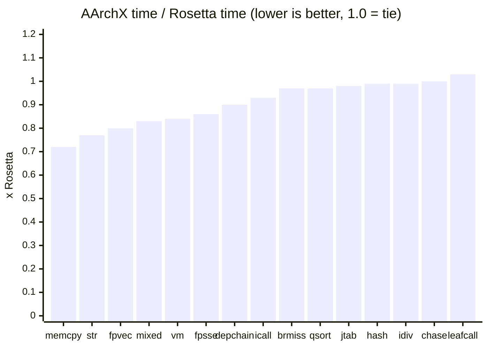

# AArchX


AArchX runs Intel (x86-64) Mac programs on Apple silicon. It translates the
program to arm64 itself, without calling Rosetta. This fork ports the original
C11 translator to Rust. The executable is still called `ocerz`, the project's
old name. You'll also see it in the source and in the `OCERZ_*` settings.

[Apple plans to limit Rosetta to certain older games after macOS 27](https://support.apple.com/en-us/102527).
AArchX is an open-source alternative, but it's experimental. Don't rely on it
for production work.

## Quick start

On an Apple silicon Mac running macOS 26 or 27, install the Xcode Command Line
Tools (`xcode-select --install`) and [rustup](https://rustup.rs/). This branch
uses `nightly-2026-10-08`. From the repository root:

```sh
make -j12 ocerz
./ocerz version                 # AArchX 0.6
./ocerz tests/guest/bin/hello   # hello from x86_64 guest
```

The bundled `hello` test needs no system libraries. To run an app, give
`ocerz` the path to its Intel executable or to the bundle itself:

```sh
./ocerz /Applications/Some.app
```

For a bundle, `ocerz` reads the executable name from `Info.plist`. Arguments
after the path go to the program.

For apps that use system libraries, there are two [modes](docs/modes.md):

| | Cache mode (`-cache`, default) | Native mode (`-native`) |
| --- | --- | --- |
| Where library code runs | AArchX translates the libraries in Apple's x86-64 shared cache. | Calls go to the Mac's arm64 frameworks. |
| What to install | Rosetta, for the shared cache file only. | No Rosetta or x86 system libraries. Generate the API databases from your macOS SDK. |
| When to use it | Start here for the widest app compatibility. | Use it to run without the shared cache. Fewer apps work. |

To try native mode:

```sh
make apis
./ocerz -native ./some_x86_64_tool
```

## What runs

The [compatibility notes](docs/compatibility.md) record what each app did
when tested, not just whether it launched. These runs predate the Rust port.

| Program | Result |
| --- | --- |
| Command-line tools | 16 matched native output byte for byte. A separate sweep compared 74 system tools with Rosetta; differences were confined to output that changes between runs. |
| Safari and Discord | In cache mode, Safari browsed and Discord reached its signed-in view (September 2026). |
| Steam (macOS) | The full client UI ran with software rendering in cache mode and with GPU acceleration in native mode on macOS 27. |
| Brawlhalla | Launched from Steam and reached the menus. |
| Ollama | The CLI, HTTP server and menu-bar app ran. Model inference wasn't tested in the recorded run. |
| Chess, Calculator, TextEdit and other bundled apps | Opened windows on macOS 26. Their macOS 27 versions are arm64-only. |
| Wine | 32-bit Notepad and WineMine opened through WoW64. Windows Steam reached its main window. |
| Counter-Strike 2 | Under Wine with D3DMetal, the game opened a window, then hit an error Rosetta didn't. |
| Photoshop | Stopped during startup. |

Some system calls and framework APIs are still missing. In native mode,
`make guest-swift` installs an x86 Swift runtime for programs that use the
standard library, but the system frameworks' Swift APIs aren't bridged.
WebKit and GameKit support is incomplete. If an import won't bind or a program
calls an export with no bridge, AArchX stops and names it. See the
[compatibility limits](docs/compatibility.md#known-limitations) and
[native-mode limits](docs/native-mode.md#what-native-mode-cannot-run-yet).

## Performance

On an Apple M5 running macOS 27 on September 21, 2026, AArchX beat Rosetta on
most of these 15 kernels. Both ran the same x86-64 binary linked against
libSystem; AArchX used cache mode. Each bar is AArchX time divided by Rosetta
time, with startup excluded. Below 1.0 means AArchX was faster.



Most of the AVX2 and FMA loops tested were faster than Rosetta's, too. In
native mode, a call to `getpid` through the bridge took about 17 ns.

Starting a large app can be several times slower: AArchX has to translate code
it hasn't seen before. Windows Steam under Wine took about 33 seconds to reach
its main window, versus 11–12 seconds under Rosetta. The [performance
notes](docs/performance.md) cover startup, the other modes and how to reproduce
the benchmarks.

## How it works

AArchX's Mach-O loader maps the executable into a reserved part of its own
process (the guest arena) and sets up the stack the program expects at launch.
Its dynamic linker resolves imports against the shared cache or, in native
mode, builds x86 stubs that call into arm64 frameworks.

The decoder reads x86 instructions a block at a time. The JIT keeps guest
registers in arm64 registers, computes flags only when needed and joins blocks
along frequently taken paths into superblocks. It uses hand-written arm64 for
common string and memory routines. Processes can reuse translated blocks from
a shared disk cache.

Instructions the JIT doesn't handle run in the interpreter, including some MMX
and AVX2 instructions. x87 loads and stores preserve all 80 bits, but
arithmetic uses 64-bit doubles.

AArchX also handles guest system calls, Mach messages, threads and signals,
translating pointers, structures and thread IDs where macOS expects different
values. A single-threaded program normally uses plain memory accesses. Creating
a second thread, forking or mapping writable shared memory switches the process to
stronger x86 memory ordering for the rest of its run.

## Testing

`make check` builds and runs the test suites and takes roughly half an hour.
The guest suite runs each program twice, once in the interpreter and once with
the JIT, and checks the output byte for byte. The i386 differential test also
compares registers, flags and memory.

These are the [September 2026 results](docs/testing.md) from macOS 27, before
the Rust port:

| Suite | Passed / total |
| --- | ---: |
| x86-64 guest programs | 131 / 131 in each mode (interpreter and JIT) |
| x86-64 differential | 97 / 97 |
| i386 differential | 20,033 / 20,033 |
| Dynamic linking | 113 / 113 |
| Native mode | 87 / 87 |

On this branch, `bash tools/rust_gate.sh` compares the build's failures with
the [C baseline](agents/baseline.md) so known failures don't hide new ones.

## Documentation

- [Getting started](docs/getting-started.md): running a program and passing arguments.
- [Modes](docs/modes.md) and [native mode in depth](docs/native-mode.md): how AArchX calls system libraries.
- [Reference](docs/reference.md): flags, environment variables and exit codes.
- [Troubleshooting](docs/troubleshooting.md): where to look when a program fails.
- [Architecture](docs/architecture.md) and [How AArchX works](docs/AArchX-Deep-Dive.pdf) (231-page PDF): the loader, translator and runtime.
- [Source atlas](docs/atlas/index.html) ([online edition](https://mont127.github.io/AArchX/atlas/)): a guided tour of the code. Individual source files explain their design in an opening comment.

## Contributing

Read the [contribution guide](CONTRIBUTING.md) for tests and commit style,
and the [Rust port notes](AGENTS.md) for this branch's build and test rules.
Please follow the [code of conduct](CODE_OF_CONDUCT.md) and report security
issues [privately](SECURITY.md).

## License

Copyright (c) 2026 mont127. AArchX and contributions to it are licensed under
the [GNU Lesser General Public License, version 2.1 or later](LICENSE).
Earlier commits retain the licenses they were published under.

You can use, build, study, modify and redistribute AArchX, including alongside
your own software. If you distribute AArchX, keep the notices and provide or
offer the corresponding source, including your changes, under the same terms.
Running a program through `ocerz`, or launching `ocerz` from it, doesn't change
that program's license. The license does not grant use of the AArchX name for
a modified version or imply endorsement.

The optional guest runtimes in `runtime/guest` have their own licenses. For
LLVM's C++ runtime, see `LICENSE.libcxx.txt`, `LICENSE.libcxxabi.txt` and
`LICENSE.libunwind.txt` there. The Swift runtime installed by `make guest-swift`
uses the Apache License 2.0 with the Runtime Library Exception
(`LICENSE.swift.txt`).
